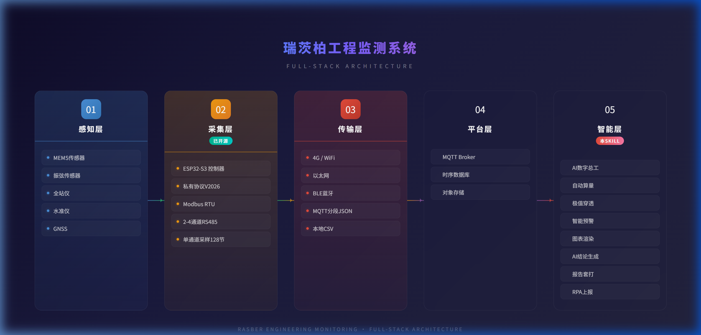

# 🧠 Engineering Monitoring — 工程监测智能报告 Agent

面向工程安全监测的数据整理、计算复核与报告编制技能指令集，探索将自动化监测和人工观测放进同一条可追溯的工作流程。

**当前版本：技能文档 v1.1.0（2026-11-10）。** 本仓库提供 `SKILL.md`、计算口径参考、架构图和示范报告，尚未提供可运行的软件平台或计算程序。AI 工具具备的文件读取、代码执行、绘图和导出能力决定实际能完成哪些步骤。

## 这次更新了什么？

- 区分本期变化量（如 mm）与变化速率（如 mm/d），按实际观测时间间隔计算。
- 补充测斜半差、角度、段投影变化与剖面位移的区别，以及基准、段长和固定端要求。
- 将数据质量与超限判定分开：疑似异常值保留原始记录与超限提示，等待复核。
- 明确阈值来源、单位、正负方向与等号边界；缺配置时标记未判定。
- 测点更换只有在联测关系确认后才能拼接；缺测、冲突和基准变化在报告中可见。
- 报告结论限定在数据能支持的范围，不再将“未超限”直接写成“安全受控”或“趋于收敛”。

## 解决什么问题？

工程监测日报常涉及多个工作表、历史基准、人工水准记录、仪器数据和巡视照片。人工合并时容易出现单位混用、时间错位、隐藏公式无法追溯，以及图表与结论不一致。

本技能把这些工作拆成可检查的步骤：

```text
原始观测 + 项目监测方案 + 阈值与基准配置
                    ↓
数据规范化与来源登记 → 缺测/冲突/异常标记
                    ↓
可复算的数值计算 → 极值与阈值比对
                    ↓
成果表、图表、复核清单与报告草稿
                    ↓
项目审核 → 按用户授权导出或提交
```

人工与自动化数据保留各自来源，在同一时间轴展示；只有测量对象、时间、基准、方向和单位可比时才进行数值比较，不直接覆盖或平均。

## 当前内容与集成方向

| 内容 | 当前状态 |
|------|----------|
| 数据整理、计算复核、异常处理和报告规则 | 已提供技能文档，需在具备相应工具的 AI 环境中执行 |
| 计算口径与合成核对示例 | 已提供参考文档，无内置计算引擎 |
| Excel 示范日报 | 已有展示文件；未作为 v1.1.0 规则的验收样本，不能直接套用其中阈值或结论 |
| MQTT、Modbus、控制器协议接入 | 集成方向，本仓库未包含协议适配器 |
| 手机表单、OCR、数据库、审计存储 | 集成方向，需另行实现与验证 |
| PDF 模板、邮件分发、监管平台 RPA | 集成方向，依赖实际工具、平台规则和用户授权 |

没有基于本仓库的端到端性能测试或漏报率验证，因此不承诺固定出报告时间或“零漏报”。具体格式、仪器型号和数据量需用真实样本验证。

## 文件说明

| 文件 | 用途 |
|------|------|
| [SKILL.md](SKILL.md) | AI Agent 入口：任务边界、数据整理、异常复核、报告与提交规则 |
| [references/calculation-rules.md](references/calculation-rules.md) | 执行计算时读取：公式、方向、测斜、阈值、基准变更和核对示例 |
| [assets/架构流程图.png](assets/架构流程图.png) | 整体方案架构示意，不代表图中模块均已实现 |
| [示范报告.xlsx](示范报告.xlsx) | 历史 Excel 示范日报，仅用于了解展示形式 |

## 快速开始

### 在 AI 对话工具中使用

1. 使用支持文件读取的 AI 工具，提供 [SKILL.md](SKILL.md) 和 [计算口径参考](references/calculation-rules.md)；也可直接提供完整仓库目录。计算时需要能够执行代码或调用可靠计算工具。
2. 上传原始监测文件、项目监测方案及阈值/基准配置，有现成报告模板时一并提供。保留原文件副本。
3. 说明报告期、时区、应测点范围、单位和方向约定。可以使用下面的请求：

```text
请按 SKILL.md 处理附件，先核对测点、时间、单位、基准和阈值来源。
按实际观测间隔计算本期变化量、累计变化量和平均变化速率。
分别列出超限、待复核、缺测及无法判定项，并给出来源位置。
生成报告草稿；缺少依据的指标留空并说明原因。
```

4. 核对计算结果、缺测范围和异常清单，再由项目人员完成正式报告审核。仅提供本期数据时，AI 应明确哪些历史指标不能计算。

只粘贴 `SKILL.md` 而不提供其引用文件时，AI 无法读取仓库中的详细计算口径；请同时提供参考文档。

### 集成到自有平台

建议由确定性程序完成解析、单位转换、标定计算和阈值判断，再将结果及来源提供给大模型组织文字。平台需要自行实现以下环节：

```text
文件/接口接入 → 数据与配置校验 → 计算服务 → 结果及来源存储
                                               ↓
                                  LLM 组织报告文字与复核说明
                                               ↓
                                  图表与模板导出 → 审核与分发
```

`SKILL.md` 可作为模型工作指令，参考文档在涉及计算时一并加载。阈值、应急处置规则和基准参数由项目配置提供，不从提示词示例直接生成生产配置。保存源文件、参数版本、计算结果和报告版本，才能实现可追溯。

## 系统架构与硬件生态



上图展示整体方案方向。相关的 [ESP32-S3 开源控制器项目](https://github.com/winterzh/rasber-controller) 位于独立仓库，其协议、部署和许可请以该仓库当前说明为准。本仓库不包含硬件固件或在线云平台。

适用的数据整理与报告场景包括深基坑、隧道、边坡、大坝、建筑沉降及其他工程监测。不同场景的计算模型、监测频次和阈值必须按具体项目确认，不能直接套用同一组参数。

## 关于瑞茨柏

苏州瑞茨柏工程监测技术有限公司，专注于工程安全监测领域。

如需从传感器、采集设备到报告流程的整体项目合作，可通过微信服务号 **瑞茨柏监测互联** 联系技术团队，沟通适用范围与交付要求。

欢迎通过 Issue 提供脱敏后的格式样例、计算口径问题或改进建议。

---

*瑞茨柏，与行业同行，让监测更轻松。*
*硬件开源，给您自由与透明；软件智能，给您效率与省心。*
